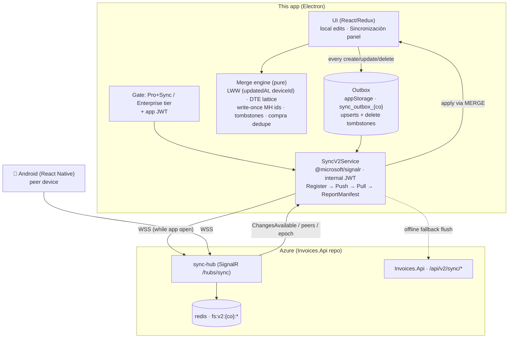

# Facturas Simples — Desktop (Electron)

Desktop client for Facturas Simples, the El Salvador electronic invoicing (DTE) system.
Electron + Vite + React 19 + Redux Toolkit. Local-first: everything works offline; sync is a
paid capability.

> Project conventions and architecture notes live in [CLAUDE.md](CLAUDE.md). Specs use
> [OpenSpec](https://github.com/Fission-AI/OpenSpec) under `openspec/` (validate:
> `openspec validate --all --strict`).

## Device Sync v2 (shipped — `openspec/changes/add-device-sync-v2`)

Desktop is a **pilot platform** (with Android) for same-owner, cross-device sync — the defining
capability of the **Pro+Sync** tier (NOT part of Free or plain Pro/ad-free; nothing is stored
in Azure Storage or SQL). Devices are the source of truth; the server relays; everything scales
to zero. Full strategy + cost model:
[`App.ReactNative/docs/SYNC_V2_REDIS_SIGNALR_STRATEGY.md`](../App.ReactNative/docs/SYNC_V2_REDIS_SIGNALR_STRATEGY.md);
server contract: [`Invoices.Api/openspec/changes/add-device-sync-v2/`](../Invoices.Api/openspec/changes/add-device-sync-v2/proposal.md).
User-facing docs (es-SV): `../App.ReactNative/FacturasSimplesRN/docs/manual-de-usuario.md` §12.

Shipped UX (release 1.3.0+): Configuración → Sincronización offers "Vincular empresa" (MH
credential claim), "Sincronizar ahora" burst sessions, "Automático" only when the device
directory reports >1 device, and the free 1-month sync trial (once per account, no card) on
the locked panel. Product photos (≤12 KB) sync with the product payload; POS tickets and their
stock movements are synced entities.



Highlights:

- **Durable outbox** — edits survive crashes/offline; entries clear only on server ack.
- **Foreground loop** — `Register` → flush → `Pull(cursor)` → apply → `ReportManifest`, debounced
  ~2 s; REST fallback when the socket is down.
- **DTE invariants** — status lattice `Nueva < Sincronizando < Completada < Anulada` never
  regresses; `generationCode`/`controlNumber`/`receptionSeal` are write-once (conflicts surfaced).
- **Correlativo seeding** — `next = max(local, server max) + 1` avoids cross-device `numeroControl`
  collisions at MH.
- **Epoch reset** — Redis loss self-heals: devices drop cursors, stagger 0–30 s, re-seed snapshots.

## Development

```bash
npm install
npm run dev            # Vite dev server
npm test               # Jest unit tests (src/__tests__)
npm run test:e2e       # Playwright (web, 61 specs)
npm run test:e2e:electron   # Playwright (packaged Electron)
```
